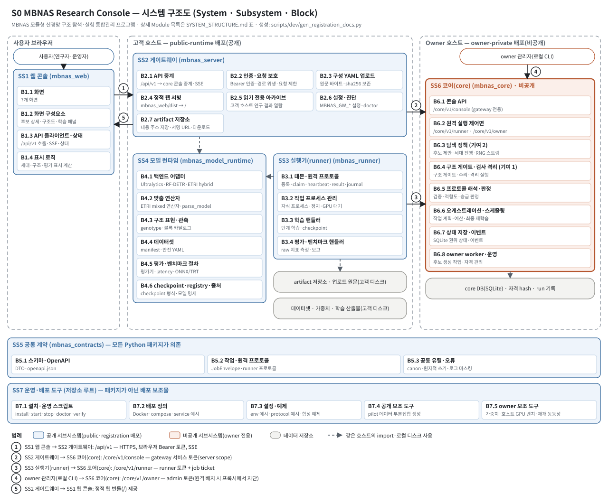
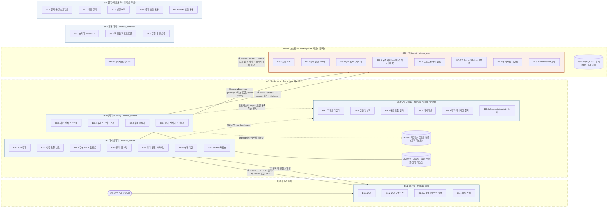

# SYSTEM_STRUCTURE — 시스템 구조 (System · Subsystem · Block · Module)

## 1. 계층 정의

| 계층 | 이 문서에서의 뜻 | 식별자 |
|---|---|---|
| System | 등록 대상 프로그램 전체 | `S0` |
| Subsystem | 하나의 배포 단위(설치 패키지) 또는 배포 보조물 묶음. 실행 위치(신뢰 영역)가 하나로 정해진다 | `SS1`–`SS7` |
| Block | Subsystem 안에서 하나의 책임을 갖는 기능 묶음 | `B<서브시스템 번호>.<순번>` |
| Module | 소스 파일(Python 모듈, TypeScript 파일) 또는 배포 보조 파일 | 패키지 기준 상대 이름 |

## 2. 신뢰 영역과 배포 구분

- **사용자 브라우저**: 웹 콘솔(SS1)의 빌드 산출물이 실행된다. 번들은 gateway가 정적으로 제공한다(Node 런타임 불필요).
- **고객 호스트(public-runtime 배포)**: gateway(SS2), runner(SS3), model runtime(SS4), 공통 계약(SS5). 고객 장비에서 실행되므로 이 코드는 비밀로 둘 수 없다.
- **Owner 호스트(owner-private 배포)**: core(SS6). 탐색 정책·구조 게이트 규칙·판정·권위 상태·자격 정보는 이 호스트에만 있다. core는 구조 관측을 위해 model runtime(SS4)과 공통 계약(SS5)도 함께 설치한다.
- **배포 보조물(SS7)**: 설치·운영 스크립트, 배포 정의, 설정·예제. 프로필별로 포함 범위가 다르다(`SUBMISSION_SCOPE_TABLE.md`).

## 3. Subsystem 요약

<!-- BEGIN GENERATED:structure-summary -->
System **S0 MBNAS Research Console** (MBNAS 모듈형 신경망 구조 탐색·실험 통합관리 프로그램)

| ID | Subsystem | 패키지·위치 | 실행 위치(신뢰 영역) | 배포 범위 | 구현 언어 | Block 수 | Module 수 | 역할 |
|---|---|---|---|---|---|---:|---:|---|
| SS1 | 웹 콘솔 | `mbnas_web` | 사용자 브라우저 | owner · public · registration(소스 + 빌드 dist) | TypeScript · React | 4 | 68 | 브라우저 화면. gateway가 정적으로 제공하는 빌드 산출물(dist/)이 실행된다. |
| SS2 | 게이트웨이 | `mbnas_server` | 고객 호스트 — public-runtime 배포(공개) | owner · public · registration | Python · FastAPI | 7 | 30 | 사용자 대면 /api/v1 서버(기본 포트 8710). core 콘솔 API로 중계하고 웹 번들과 아카이브를 제공한다. |
| SS3 | 실행기(runner) | `mbnas_runner` | 고객 호스트 — public-runtime 배포(공개) | owner · public · registration | Python | 4 | 23 | 고객 GPU 호스트에서 학습·평가·벤치마크 작업을 실행한다. core에서 작업을 임대(lease)받는다. |
| SS4 | 모델 런타임 | `mbnas_model_runtime` | 고객 호스트 — public-runtime 배포(공개) | owner · public · registration | Python · PyTorch | 6 | 49 | 승인된 모델을 구축·학습·평가하는 공개 백엔드. runner와 gateway가 같은 호스트에서 import한다. |
| SS5 | 공통 계약 | `mbnas_contracts` | 공통(모든 Python 패키지가 의존) | owner · public · registration | Python | 3 | 24 | 모든 Python 패키지가 공유하는 DTO·OpenAPI·작업 프로토콜·공통 유틸(외부 의존 pydantic·PyYAML만). |
| SS6 | 코어(core) | `mbnas_core` | Owner 호스트 — owner-private 배포(비공개) | owner 전용(비공개) | Python · FastAPI · SQLite | 8 | 비기재 | Owner 호스트에서만 실행되는 비공개 서브시스템(기본 포트 8700). 탐색 정책·판정·권위 상태를 가진다. |
| SS7 | 운영·배포 도구 | `(저장소 루트)` | 배포 보조물 | 프로필별(블록 행 참조) | Bash · Python · Docker | 5 | 28 | 설치·기동·정지·진단·검증 스크립트, 배포 정의, 설정·예제. 패키지가 아닌 배포 보조물이다. |
<!-- END GENERATED:structure-summary -->

## 4. 구조도

- 도식 파일: `diagrams/system_structure.svg`(편집 가능한 SVG 텍스트, 각 Subsystem·Block이 `id`를 가진 `<g>` 요소), `diagrams/system_structure.mmd`(mermaid 소스).
- 번호 화살표 ①–⑤는 `INTERFACES.md`의 인터페이스 ID와 같다. 점선은 같은 호스트 안의 import 또는 로컬 디스크 사용이다.

mermaid 소스(위 SVG와 같은 데이터):

<!-- BEGIN GENERATED:mermaid -->

<!-- END GENERATED:mermaid -->

## 5. Block · Module 표

<!-- BEGIN GENERATED:structure-table -->
| Subsystem | Block | Module | 배포 범위 | 설명 |
|---|---|---|---|---|
| SS1 웹 콘솔 | B1.1 화면 | `screens/Archive.tsx`, `screens/Compare.tsx`, `screens/History.tsx`, `screens/Lineage.tsx`, `screens/Monitor.tsx`, `screens/Server.tsx`, `screens/Settings.tsx` | owner · public · registration(소스 + 빌드 dist) | 아카이브·Run 비교·탐색 모니터링·실험 설정·모델 계보·실행 기록·서버 연결 화면 |
| SS1 웹 콘솔 | B1.2 화면 구성요소 | `components/ArtifactDownload.tsx`, `components/ArtifactImage.tsx`, `components/CandidateModal.tsx`, `components/CandidateView.tsx`, `components/Capabilities.tsx`, `components/ConfigRevisions.tsx`, `components/DataTable.tsx`, `components/FinalRun.tsx`, `components/Modal.tsx`, `components/ModelComparison.tsx`, `components/ModelConfigUpload.tsx`, `components/ModelStructure.tsx`, `components/Nav.tsx`, `components/RegistryStructureButton.tsx`, `components/Scatter.tsx`, `components/TrainingPanel.tsx`, `components/TrainingProgress.tsx`, `components/archive/ArchiveBits.tsx`, `components/archive/ArchiveCandidateModal.tsx`, `components/archive/ArchiveScatter.tsx`, `components/archive/BaselineTable.tsx`, `components/archive/CandidateTable.tsx`, `components/archive/FidelityCard.tsx`, `components/archive/GenerationChart.tsx`, `components/archive/GenerationDetail.tsx`, `components/archive/LineChart.tsx`, `components/archive/LiveCard.tsx`, `components/archive/OverviewCard.tsx`, `components/archive/PlotsCard.tsx`, `components/archive/RunPicker.tsx`, `components/ui.tsx` | owner · public · registration(소스 + 빌드 dist) | 후보 상세(gene 구성도·블록 표·구성 YAML), 구조 비교, 학습 패널, 진행 곡선, 아카이브 카드 |
| SS1 웹 콘솔 | B1.3 API 클라이언트·상태 | `App.tsx`, `api/client.ts`, `api/sse.ts`, `api/sync.ts`, `api/types.gen.ts`, `api/types.ts`, `main.tsx`, `state/context.tsx`, `state/reducer.ts`, `styles.css` | owner · public · registration(소스 + 빌드 dist) | /api/v1 호출과 SSE 수신·재연결, 계약 생성 타입(types.gen.ts), 화면 상태·URL 복원 |
| SS1 웹 콘솔 | B1.4 표시 로직 | `archive/api.ts`, `archive/format.ts`, `archive/hash.ts`, `archive/palette.ts`, `archive/pareto.ts`, `archive/types.ts`, `lib/artifacts.ts`, `lib/cohort.ts`, `lib/configRevisions.ts`, `lib/download.ts`, `lib/evaluation.ts`, `lib/finalretrain.ts`, `lib/fitness.ts`, `lib/format.ts`, `lib/generation.ts`, `lib/lines.ts`, `lib/policy.ts`, `lib/runflow.ts`, `lib/structure.ts`, `lib/validate.ts` | owner · public · registration(소스 + 빌드 dist) | 세대·코호트·구조·평가 값의 표시용 계산과 형식화(아카이브 Pareto 표시 포함) |
| SS2 게이트웨이 | B2.1 API 중계 | `api`, `api.app`, `api.contract_check`, `api.core_client`, `api.deps`, `api.errors`, `api.gateway_inputs`, `api.relay`, `api.validate_prep` | owner · public · registration | /api/v1 요청을 core /core/v1/console로 중계(SSE 포함), 검증·run 생성 때 고객 호스트 경로·데이터셋 manifest 측정값 동봉, 오류 코드·request id 중계 |
| SS2 게이트웨이 | B2.2 인증·요청 보호 | `api.auth`, `api.limits`, `api.path_guard` | owner · public · registration | 브라우저 Bearer 토큰 검사(상수 시간 비교), 경로 위생(dot segment 거부·경로 인자 인코딩), 요청률·고비용 동시성·SSE 연결 수 제한, 감사 로그 |
| SS2 게이트웨이 | B2.3 구성 YAML 업로드 | `api.uploads` | owner · public · registration | 모델 구성 YAML 업로드(≤1 MiB), 원문 바이트와 sha256을 고객 측 저장소에 보존 |
| SS2 게이트웨이 | B2.4 정적 웹 서빙 | `api.static_web` | owner · public · registration | 빌드된 웹 번들(mbnas_web/dist)을 / 경로로 제공(SPA fallback), 고객 서버에 Node 불필요 |
| SS2 게이트웨이 | B2.5 읽기 전용 아카이브 | `archive`, `archive.analysis`, `archive.campaign`, `archive.live`, `archive.parsers`, `archive.routes`, `archive.scanner`, `archive.views` | owner · public · registration | 고객 호스트에 있는 연구 run 결과를 읽기 전용으로 열람(/api/v1/archive/*, GET 13종) |
| SS2 게이트웨이 | B2.6 설정·진단 | `__init__`, `config`, `doctor` | owner · public · registration | MBNAS_GW_* 설정 로딩·검증, mbnas-gateway-doctor 진단 |
| SS2 게이트웨이 | B2.7 artifact 저장소 | `api.artifact_routes`, `artifacts`, `artifacts.download`, `artifacts.signing`, `artifacts.store` | owner · public · registration | 고객 측 artifact 저장소(sha256 내용 주소, 원자적 쓰기), 서명 URL, digest 재검증 다운로드, 내보내기 ZIP 조립, 구성 개정 원문 제공 |
| SS3 실행기(runner) | B3.1 데몬·원격 프로토콜 | `__init__`, `__main__`, `client`, `config`, `daemon`, `envelope`, `journal`, `reports`, `transfer` | owner · public · registration | register→claim→start→heartbeat→progress→checkpoint/artifact→result→ack 수행, 로컬 journal로 멱등 재전송, TLS 검증, artifact 바이트의 고객 측 저장소 전송 |
| SS3 실행기(runner) | B3.2 작업 프로세스 관리 | `child`, `contract`, `gpu`, `gpu_guard` | owner · public · registration | 작업별 자식 프로세스 실행·정지 신호·GPU 점유 대기와 장치 할당 |
| SS3 실행기(runner) | B3.3 학습 핸들러 | `training`, `training.context`, `training.handlers`, `training.recipe`, `training.stage_trainer` | owner · public · registration | rung 단위 학습, full-state checkpoint 저장·재개, 학습 recipe 해석 |
| SS3 실행기(runner) | B3.4 평가·벤치마크 핸들러 | `benchmark`, `benchmark.handlers`, `evaluation`, `evaluation.handlers`, `evaluation.official_evaluation` | owner · public · registration | 평가·공식 가중치 평가·벤치마크 작업 실행과 raw 지표 보고(적합도·승급 판정은 하지 않음) |
| SS4 모델 런타임 | B4.1 백엔드 어댑터 | `adapters`, `adapters.base`, `adapters.common`, `adapters.etri_hybrid`, `adapters.etri_hybrid.adapter`, `adapters.etri_hybrid.boxes`, `adapters.etri_hybrid.criterion`, `adapters.etri_hybrid.data`, `adapters.etri_hybrid.loss`, `adapters.etri_hybrid.model`, `adapters.etri_hybrid.postprocess`, `adapters.rfdetr_adapter`, `adapters.structure_native`, `adapters.ultralytics_adapter` | owner · public · registration | Ultralytics(YOLO11/YOLO26/RT-DETR), RF-DETR, ETRI hybrid 모델 어댑터와 native 구조 관측 |
| SS4 모델 런타임 | B4.2 맞춤 연산자 | `operators`, `operators.etri_mixed_blocks`, `operators.parse_model_8_4_173` | owner · public · registration | ETRI mixed 연산자 3종(vendored)과 ultralytics 8.4.173 parse_model 정적 확장(exec 미사용) |
| SS4 모델 런타임 | B4.3 구조 표현·관측 | `block_catalog`, `genotype`, `genotype_audit` | owner · public · registration | YAML genotype 해석·선언 검사(모듈 허용목록·인자 한도), 구조 관측, 블록 설계 출처 카탈로그 |
| SS4 모델 런타임 | B4.4 데이터셋 | `datasets`, `datasets.coco_convert`, `datasets.manifest`, `datasets.subset`, `datasets.yaml_safe`, `datasets.yolo_view` | owner · public · registration | 데이터셋 YAML 안전 파싱, split manifest·hash 계산, 부분집합·COCO 변환 |
| SS4 모델 런타임 | B4.5 평가·벤치마크 절차 | `benchmark`, `benchmark.accuracy`, `benchmark.capability`, `benchmark.onnx_export`, `benchmark.onnx_runtime`, `benchmark.pipeline`, `benchmark.profile`, `benchmark.subjects`, `benchmark.trt_build`, `benchmark.trt_runtime`, `evaluation`, `evaluation.evaluator`, `evaluation.images`, `evaluation.latency`, `evaluation.matching`, `evaluation.size` | owner · public · registration | 평가기(정합·이미지 산출), latency·크기 측정, ONNX/TensorRT 벤치마크 절차 |
| SS4 모델 런타임 | B4.6 checkpoint·registry·출처 | `__init__`, `checkpoint`, `provenance`, `provenance.env_lock`, `registry`, `registry.probe`, `registry.specs` | owner · public · registration | checkpoint 형식·검증, baseline 모델 명세·probe, 실행 환경 lock 기록 |
| SS5 공통 계약 | B5.1 스키마·OpenAPI | `openapi`, `schemas`, `schemas.api`, `schemas.archive`, `schemas.enums`, `schemas.jobs`, `schemas.protocol`, `schemas.records` | owner · public · registration | 공개 DTO 스키마(pydantic), 공개 API·runner 프로토콜 OpenAPI 문서와 계약 이력 |
| SS5 공통 계약 | B5.2 작업·원격 프로토콜 | `constants`, `jobs_protocol`, `protocol_hash`, `runner_protocol`, `structure_doc` | owner · public · registration | 작업 프로토콜 타입, runner 프로토콜 모델, protocol_hash, 구조 문서 상수, 기본 baseline 상수 |
| SS5 공통 계약 | B5.3 공통 유틸·오류 | `__init__`, `asgi`, `errors`, `util`, `util.atomic`, `util.canon`, `util.home`, `util.log_redact`, `util.paths`, `util.source_hash`, `util.time` | owner · public · registration | 정규 직렬화·원자적 쓰기·경로 검사·로그 마스킹·시간 유틸, 오류 본문, ASGI 미들웨어 |
| SS6 코어(core) | B6.1 콘솔 API | `mbnas_core`: api, console (파일 목록 비기재) | owner 전용(비공개) | gateway 전용 콘솔 API(서비스 토큰), 공개 응답 투영 지점 |
| SS6 코어(core) | B6.2 원격 실행 제어면 | `mbnas_core`: runner_api (파일 목록 비기재) | owner 전용(비공개) | runner 작업 임대·fencing·job ticket·lease 회수, owner 조회 API |
| SS6 코어(core) | B6.3 탐색 정책 (기여 2) | `mbnas_core`: search (structure 제외), search.mixed_pool (파일 목록 비기재) | owner 전용(비공개) | 후보 제안(GA·IndependentRandom·RandomGeneration), 세대 진행, seed별 RNG 스트림, 계보 기록 |
| SS6 코어(core) | B6.4 구조 게이트·검사 격리 (기여 1) | `mbnas_core`: search.structure, structure (파일 목록 비기재) | owner 전용(비공개) | 후보·사용자 구조 게이트와 수리(repair), 자원 제한 서브프로세스 격리 실행 |
| SS6 코어(core) | B6.5 프로토콜 해석·판정 | `mbnas_core`: protocol (파일 목록 비기재) | owner 전용(비공개) | 실험 프로토콜 검증·해석, 적합도·승급 판정(비공개 규칙) |
| SS6 코어(core) | B6.6 오케스트레이션·스케줄링 | `mbnas_core`: orchestration, scheduling, training_runs, artifacts, export (파일 목록 비기재) | owner 전용(비공개) | 작업 계획·예산 승인·비용 기록, 별도 학습 run, 최종 재학습, artifact 등록, 내보내기 |
| SS6 코어(core) | B6.7 상태 저장·이벤트 | `mbnas_core`: db, events (파일 목록 비기재) | owner 전용(비공개) | run·후보·평가·작업·비용·checkpoint 권위 상태(SQLite)와 이벤트 버스 |
| SS6 코어(core) | B6.8 owner worker·운영 | `mbnas_core`: owner_worker, ops, registry, config (파일 목록 비기재) | owner 전용(비공개) | 후보 생성(PROPOSE_GENERATION) 전용 owner worker, 자격(principal) 관리, 진단, registry 상태 |
| SS7 운영·배포 도구 | B7.1 설치·운영 스크립트 | `scripts/doctor.sh`, `scripts/install.sh`, `scripts/start.sh`, `scripts/stop.sh`, `scripts/verify.sh` | owner · public · registration | 설치·기동·정지·진단·검증 스크립트 |
| SS7 운영·배포 도구 | B7.2 배포 정의 | `deploy/public/Dockerfile`, `deploy/public/Dockerfile.cpu`, `deploy/public/docker-compose.yml`, `deploy/public/docker-entrypoint.sh`, `deploy/public/mbnas-gateway.service.example`, `deploy/public/mbnas-runner.service.example`, `deploy/public/nginx.example.conf` | owner · public · registration(deploy/owner는 owner) | Docker 이미지·compose·systemd/nginx 예시(public; owner 정의는 owner 배포본 전용) |
| SS7 운영·배포 도구 | B7.3 설정·예제 | `config/examples/core.env.example`, `config/examples/gateway.env.example`, `config/examples/model_registry.example.json`, `config/examples/owner-all-in-one.env.example`, `config/examples/protocol.example.json`, `config/examples/protocol.pilot_smoke.example.json`, `config/examples/runner.env.example`, `examples/make_synthetic_dataset.py`, `examples/models/yolo11n_user.yaml`, `examples/models/yolo11n_user_broken.yaml`, `examples/protocol.cpu_generation_only.json`, `examples/synthetic4/data.yaml` | owner · public · registration(core·owner env 예시는 owner) | 역할별 env 예시, protocol·registry 예시, 합성 예제 데이터 |
| SS7 운영·배포 도구 | B7.4 공개 보조 도구 | `scripts/public/make_pilot_subset.py` | owner · public · registration | pilot 데이터 부분집합 생성 도구(`--source`·`--out` 필수 인자, 호스트 기본 경로 없음) |
| SS7 운영·배포 도구 | B7.5 owner 보조 도구 | `scripts/runner/bench_host_gpu.py`, `scripts/runner/download_weights.py`, `scripts/runner/resume_equivalence.py` | owner 전용(공개 ZIP 미포함) | 가중치 내려받기, 호스트 GPU 벤치마크(콘솔 큐 대신 쓰는 BENCHMARK 경로), full-state 재개 동등성 비교 |
<!-- END GENERATED:structure-table -->

## 6. 표기 원칙과 한계

- **비공개 서브시스템(SS6 core)** 은 Block과 하위 패키지 이름까지만 적는다. 파일 목록·규칙·임계값·데이터 표는 등록 문서에 적지 않는다(`KEY_CONTRIBUTIONS.md` 참조). 공개 배포본에는 core 소스가 포함되지 않는다.
- SS1–SS6의 모든 소스 모듈은 위 표의 어느 한 Block에 배정되어 있다. SS7(배포 보조물)은 주요 파일만 적는다.
- 이 문서의 구조는 설계·소스 배치 기준이다. 기능별 설명은 `docs/public/FEATURES.md`에 있다.
